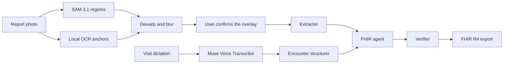

# MedEdge AI

MedEdge AI turns paper lab reports, handwritten prescriptions, and spoken visit notes into verified HL7 FHIR R4 bundles.

**MedEdge AI is an administrative data interoperability and optical ingestion pipeline, not a clinical decision or diagnostic tool.** It does not diagnose, interpret a result, or suggest treatment.

Built for the [Meta Global AI Developer Hackathon](https://dev.meta.ai/events/global-hackathon) (October 26 to November 4, 2026), Indie Developer track. Every commit in this repository is new work from that window.

## Two roles

- **Patients** add a report, confirm what is hidden, see the values exactly as printed, and share a 6-character code.
- **Doctors** open that code or upload a report, dictate an administrative visit note, review the result, and approve the export.

## Architecture



The full page goes to SAM 3.1 only, or stays on the machine when `SAM_PROVIDER=local`. A language model receives the redacted page after the user confirms the overlay. The Patient resource is a session pseudonym. `store` is false on Meta calls. Zero Data Retention is claimed only if Meta enables it on the account.

Prescriptions are transcribed. A dose such as `1+0+1` is copied into FHIR timing. The app adds no dose advice and no interaction check.

## Models

| Job | Model |
| --- | --- |
| Page, table, barcode, signature, stamp, photo | SAM 3.1 |
| Read the redacted page | Partner Muse Spark Open, else Muse Glimmer on Colab, else Muse Spark 1.3 |
| Transcribe | Muse Voice Transcribe |
| Structure the visit and build the bundle | Muse Spark 1.3 |

Set the extractor chain in `.env`, for example `ROLE_EXTRACTOR=glimmer:muse-glimmer,meta:muse-spark-1.3`. The result names the model that actually answered. `colab/glimmer_server.ipynb` serves Muse Glimmer on an L4. A Colab session can die, so the hosted demo must keep Muse Spark 1.3 in the chain.

## Checks

The bundle is checked for R4 schema, internal references, LOINC check digits, UCUM units, a one-to-one match with the source rows, and a policy that rejects diagnoses and computed interpretations. If the agent cannot produce a valid bundle, a deterministic assembler does, and the screen says "Assembled by fallback." "Inject a fault" adds one labeled failure so the repair is visible.

## Run it

Python 3.11 and Node 22.

```powershell
py -3.11 -m venv backend\.venv
backend\.venv\Scripts\python -m pip install -e "backend[dev]"
copy .env.example .env
backend\.venv\Scripts\python -m uvicorn app.main:app --app-dir backend --reload
```

```powershell
cd frontend
npm install
npm run dev
```

The app is at http://localhost:5173. Put `MODEL_API_KEY` in `.env`. Without a key, the three fictional samples still open and are labeled as recorded readings.

```powershell
backend\.venv\Scripts\python -m pytest
backend\.venv\Scripts\python -m ruff check app tests
backend\.venv\Scripts\python scripts\eval.py
```

`scripts/smoke_meta.py` calls the live Meta API and spends credit. Do not run it unless you mean to.

## Evaluation

`scripts/eval.py` checks the fictional sample sheets. These numbers are the deterministic pieces, not a claim about model accuracy:

| Check | Result |
| --- | --- |
| Unit dialects (`lakh/cumm`, `gm%`, `mg%`, `/cumm`, `mm/1st hr`, `mmol/L`) | 6/6 |
| LOINC check digits on five known codes | 5/5 |
| Sample ground truth assembled into a valid bundle | 3/3 |

`python scripts/eval.py --live` adds one extractor call when `MODEL_API_KEY` is set and reports how many printed names matched. That number is filled in after a live run. It is not invented here.

## Data

`data/samples/` holds three fictional drawings. They are not photographs of real patients. Put real reports in `data/private/raw/`. That folder is gitignored. See `data/INTAKE.md`.

## Deploy

`render.yaml` is the backend. `frontend/vercel.json` is the frontend. Set `VITE_API_BASE` to the Render URL and add that origin to `CORS_ORIGINS`. Dev routes stay off in production. Requests are limited to 30 per minute, and a daily budget stops new model calls. A sample case over budget replays its recorded reading and says so.

Local SAM 3.1 is `SAM_PROVIDER=local` plus `SAM_LOCAL_CHECKPOINT`. Without the weights the call fails with a clear error and the Meta API remains the default.

## Demo

The 2:45 shot list is in `docs/DEMO.md`. Recording, the X post, and the portal submission are done by the author from that script.
