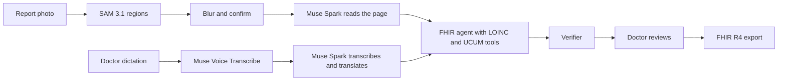

# MedEdge AI

MedEdge AI turns paper lab reports, handwritten prescriptions, and a doctor's dictated note into a verified HL7 FHIR R4 bundle. The page is anonymized before any language model reads it, and the output is checked before a person approves it.

**MedEdge AI is an administrative data interoperability and optical ingestion pipeline, not a clinical decision or diagnostic tool.** It does not diagnose, interpret a result, or suggest treatment.

Built for the [Meta Global AI Developer Hackathon](https://dev.meta.ai/events/global-hackathon) (October 26 to November 4, 2026), Indie Developer track. Every commit in this repository is new work from that window.

## Try it as a judge

The deployed app has two fictional demo accounts. The sign-in page shows "Use demo patient" and "Use demo doctor" buttons that fill the form. The password is shown there on purpose; it protects nothing real.

| Role | What to do |
| --- | --- |
| Demo patient | Open the chart. A connected doctor, a verified CBC record with its source image, and a published note are already there. Open the record to see the "How this record was made" panel and the FHIR JSON. |
| Demo doctor | Open the connected patient. Use "Use the sample dictation" to run the whole pipeline: SAM 3.1, Muse Voice, Muse Spark, the FHIR agent, and the verifier. |

Demo accounts cannot upload their own photos, change the password, or revoke the connection. Their data resets hourly. A guest tour of three fictional samples needs no account at all.

## Two roles

- **Patients** add a report photo, confirm what is hidden, see the values exactly as printed, and approve a doctor's access to their chart.
- **Doctors** open a connected patient's chart, upload a report, dictate a note, review the reading against the source, and approve the export.

Accounts need a verified email. A doctor account is self-declared and is not verification of medical credentials.

## How Meta's tools are used

| Stage | Meta tool | What it does |
| --- | --- | --- |
| Find regions | SAM 3.1 | Finds the page, table, barcode, signature, stamp, and photo. The name header and anything personal are blurred before the next step. |
| Read the page | Muse Spark 1.3 (vision) | Reads the redacted page into structured rows exactly as printed. |
| Transcribe | Muse Voice Transcribe | Turns the doctor's recording into text. |
| Translate | Muse Spark 1.3 | Gives the dictated note in English and Bangla. It does not summarize or add anything. |
| Build the bundle | Muse Spark 1.3 as an agent | Calls tools to look up LOINC and UCUM, then submits a FHIR bundle that the verifier accepts or rejects. |

Every run keeps its trace: which model answered, how long it took, each tool call, each verifier layer, and whether a deterministic fallback was used. The "How this record was made" panel shows it.



The full page goes to SAM 3.1 only. A language model receives the redacted page after the patient or doctor confirms the overlay. The Patient resource is a session pseudonym. `store` is false on Meta calls. Zero Data Retention is claimed only if Meta enables it on the account.

## What MedEdge never does

- It does not diagnose, interpret a value, or suggest treatment.
- It does not compute High or Low flags. A flag appears only if the paper printed one.
- It does not give dose advice or check interactions. A dose such as `1+0+1` is copied as written.
- It does not summarize a doctor's note. The dictated words are transcribed and translated, and the doctor publishes them as the doctor's own words.
- It does not send an unredacted page to a language model.

## Checks

The bundle is checked for R4 schema, internal references, LOINC check digits, UCUM units, a one-to-one match with the source rows, and a policy that rejects diagnoses and computed interpretations. If the agent cannot produce a valid bundle, a deterministic assembler does, and the screen says "Assembled by fallback." "Inject a fault" on a sample run adds one labeled failure so the agent's repair is visible in the trace.

## Evaluation

`scripts/eval.py` runs on the three fictional sample documents. Live numbers come from the real Meta API with `muse-spark-1.3`, no fallback used. These are small synthetic samples, so they show the pipeline works. They are not a claim about accuracy on real documents.

| Sample | Names read | Values read | Time |
| --- | --- | --- | --- |
| CBC report | 5/5 | 5/5 | 3.7 s |
| Lipid report | 4/4 | 4/4 | 3.6 s |
| Prescription | 2/2 medicines | 2/2 doses | 4.0 s |

Offline checks: 6/6 unit dialects (`lakh/cumm`, `gm%`, `mg%`, `/cumm`, `mm/1st hr`, `mmol/L`), 5/5 LOINC check digits, 3/3 sample truths assembled into valid bundles.

```powershell
backend\.venv\Scripts\python scripts\eval.py          # offline
backend\.venv\Scripts\python scripts\eval.py --live   # spends Meta credit
```

## Run it

Python 3.11 and Node 22.

```powershell
py -3.11 -m venv backend\.venv
backend\.venv\Scripts\python -m pip install -e "backend[dev]"
copy .env.example .env
backend\.venv\Scripts\python -m alembic -c backend\alembic.ini upgrade head
backend\.venv\Scripts\python -m uvicorn app.main:app --app-dir backend --reload
```

```powershell
cd frontend
npm install
npm run dev
```

The app is at http://localhost:5173. In development, verification and password-reset emails are saved as `.eml` files in `backend/var/mail/` (gitignored). Put `MODEL_API_KEY` in `.env` for live model features. To try the demo accounts locally, set `DEMO_PATIENT_EMAIL`, `DEMO_DOCTOR_EMAIL`, and a `DEMO_PASSWORD` of 12 or more characters.

```powershell
backend\.venv\Scripts\python -m pytest -c backend\pyproject.toml backend\tests
backend\.venv\Scripts\python -m ruff check backend\app backend\tests
cd frontend; npm test
```

`scripts/smoke_meta.py` calls the live Meta API and spends credit. Do not run it unless you mean to.

Role routing is set in `.env`, for example `ROLE_EXTRACTOR=glimmer:muse-glimmer,meta:muse-spark-1.3`. The result names the model that actually answered. `colab/glimmer_server.ipynb` serves Muse Glimmer on an L4. A Colab session can die, so a hosted demo keeps Muse Spark 1.3 in the chain.

## Data

`data/samples/` holds three fictional drawings and a short synthetic dictation. They are not photographs of real people. Real reports belong in `data/private/`, which is gitignored. See `data/INTAKE.md`.

## Deploy

`render.yaml` builds one Docker service with the React frontend and FastAPI backend on the same origin. Set these in Render's environment settings:

- `APP_ENV=production` and `APP_BASE_URL` set to the HTTPS origin of the app.
- `DATABASE_URL` set to a pooled Neon PostgreSQL connection string with TLS, and `DATABASE_URL_UNPOOLED` set to the direct connection string. The container uses the direct one for Alembic migrations at startup.
- `RESEND_API_KEY` and `RESEND_FROM_EMAIL` for a verified sender. Disable open and click tracking so authentication links are not rewritten.
- `MODEL_API_KEY` for live model features.
- `PSEUDONYM_SALT`, a unique random string of 16 or more characters. The app refuses to start in production with the default.
- `DEMO_PATIENT_EMAIL`, `DEMO_DOCTOR_EMAIL`, and `DEMO_PASSWORD` for the judge accounts. Leave the password unset to turn them off.

In production the app refuses to start without PostgreSQL, an HTTPS app URL, a Resend sender, and a real salt. It sends HSTS and a same-origin Content Security Policy. Dev routes stay off, and a daily budget (`DAILY_BUDGET_USD`) limits new model calls.

Render free services sleep, and their filesystem is ephemeral. Real uploads require configured private S3-compatible storage: set STORAGE_BUCKET, STORAGE_ENDPOINT, STORAGE_REGION, STORAGE_ACCESS_KEY and STORAGE_SECRET_KEY. Original images, audio and redacted previews are stored privately until the patient deletes the record. Legacy files may no longer be available. The demo accounts are reseeded at startup. For judging week, consider a paid instance to avoid cold starts.

Render deploys a Git commit, not uncommitted files. Point the service at `main`.

## Demo

The 2:45 shot list is in `docs/DEMO.md`, with draft submission and X post text. Recording, posting, and the portal submission are done by the author.
